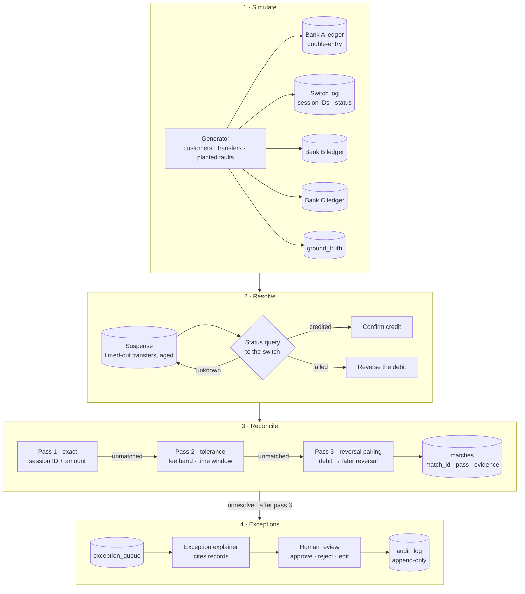
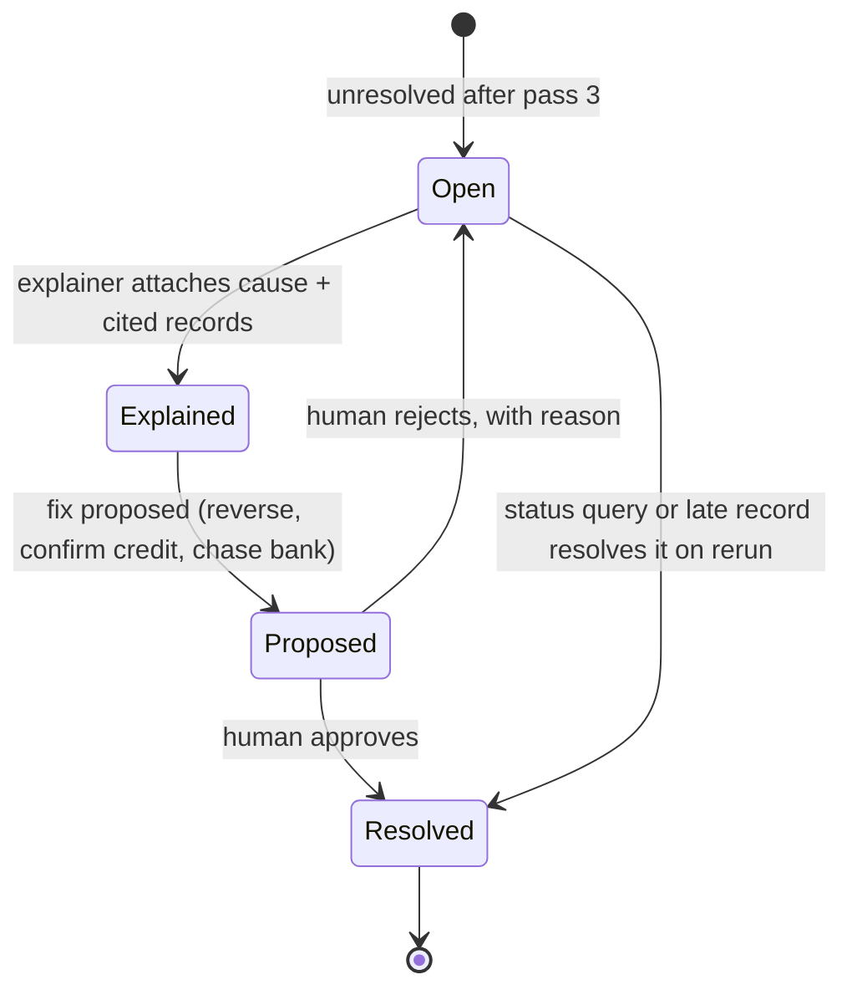

<div align="center">

# Tieout

**Follow a naira. A simulated Nigerian banking system that knows where every transfer is, and why.**

[](https://github.com/myekini/tieout/actions/workflows/ci.yml)


[](LICENSE)

</div>

> [!NOTE]
> **Status: design stage.** This README is the design for Release 1. Nothing is built yet. Build starts after [CostTrail](https://github.com/myekini/costtrail) ships its first release.

> [!IMPORTANT]
> **Simulation, not affiliated.** Tieout models how Nigerian interbank payments work using synthetic banks, customers and data. It is not affiliated with NIBSS, the CBN or any bank, and uses no real institution's data, formats or figures.

---

## The question

**Where is the money right now, and does every record agree?**

Tunde sends ₦10,000 from his bank app to Ada at another bank. It takes seconds:

```
Tunde's app → Tunde's bank (debit) → the switch (NIP) → Ada's bank (credit) → Ada
```

Usually it just works. Sometimes the request times out halfway. Tunde has been debited, Ada hasn't been credited, and nobody is sure yet whether the money arrived. Every Nigerian knows the message: *"debited but not credited."*

Behind that message, the sending bank:

1. Parks the money in a **suspense account**.
2. Asks the switch for the transaction's status (a **status query**).
3. Either confirms the credit or **reverses** the debit, sometimes days later.

Meanwhile three records have to agree: the sending bank's ledger, the switch's log and the receiving bank's ledger. When they don't, reconciliation teams find out by hand.

Tieout builds a small, fake version of that system and makes the hard part visible.

## How it grows

Each release adds one real problem and ships on its own.

| Release | Problem | AI feature |
|---|---|---|
| **R1 Transfers** *(this design)* | Interbank transfers, timeouts, status queries, suspense, reversals; ledger vs switch log | Exception explainer |
| R2 Settlement | End-of-day net settlement between banks; positions sum to zero; cutoffs and holidays | Settlement-break narrator |
| R3 Bills & airtime | Pending vends, aggregator float, statement and commission matching | Statement mapper with validation |
| R4 Cards, POS & ATM | Authorisation, clearing, settlement, merchant fees, ATM non-dispense, chargebacks | Dispute pack drafter |
| R5 Partner-bank layer | Fintech ledger vs partner bank; missed and duplicate webhooks | Investigation agent (read-only tools) |
| R6 Fraud & compliance | Mule-account patterns, transfer velocity, KYC limits | Suspicious-activity report drafter |

## What R1 does

| Capability | Detail |
|---|---|
| **A small banking system** | Three synthetic banks, one switch, synthetic customers. Each bank keeps a double-entry ledger, so every naira leaves one account and enters another |
| **Transfers with planted faults** | Timeouts, unknown status, duplicate session IDs, late reversals, wrong fees. Each fault is written to a ground-truth file |
| **Status queries and suspense** | Timed-out transfers sit in suspense with an age until a status query resolves them |
| **Reconciliation** | Each bank's ledger matched to the switch log in ordered passes, every match carrying its evidence |
| **Idempotent reruns** | Running the same inputs again changes nothing. Tested, not assumed |
| **Exception queue** | Everything unresolved becomes a case with a state, an owner and evidence; every action goes to an append-only audit log |
| **Exception explainer** | Says what happened to a stuck transfer in plain words, citing the records. Code checks every figure it quotes. If the evidence isn't there, it says so |

## Architecture



## The ledger rule

Every bank's ledger is **double-entry**: each transfer is at least two lines that net to zero (debit the customer, credit the outward-transfer account; later, clear that account against the switch). Suspense is just another account.

**The test that guards it:** after every run, every bank's ledger sums to zero, and every naira in suspense is traceable to one transfer.

## Matching, pass by pass

Each pass only sees what the previous one left unmatched, so certain matches happen first and fuzzy ones last.

| Pass | Rule | Example |
|---|---|---|
| **1 · Exact** | Same session ID, same amount | Bank A debit `S-2611…0418` ₦10,000 ↔ switch record `S-2611…0418` ₦10,000 |
| **2 · Tolerance** | Same session ID, amount differs by the fee schedule, time within the window | Ledger shows the fee charged twice; switch shows one fee |
| **3 · Reversal pairing** | A debit with no successful switch record is paired with its later reversal | Debit on Monday, reversal on Thursday |

Every match records **which pass made it and the evidence used**, so an auditor can see why two records were paired.

## Idempotency, by design

Reconciliation runs again constantly: a file was late, a fix was deployed, someone pressed the button twice. A rerun must never create a second match, a second reversal or a second exception.

| Mechanism | What it prevents |
|---|---|
| Content hash per input file | The same file loaded twice |
| Natural key per record (bank, session ID, leg, amount) | Duplicate records inside or across files |
| Deterministic `match_id` = hash of the sorted record IDs it pairs | The same match written twice |
| `MERGE` writes, never blind `INSERT` | Rows multiplying on rerun |
| Run manifest per `run_id` | Knowing exactly what each run read and wrote |

**The test that proves it:** run the pipeline, snapshot every table, run it again on the same inputs, assert the diff is empty.

## Exception lifecycle



## The exception explainer

**What it can do**
- Read the evidence for one case: the ledger lines, the switch record (or its absence), the status-query history and the suspense age.
- Pick one cause from a fixed list (timeout then credited, timeout then failed, duplicate session, late reversal, fee error, missing switch record) and propose one fix.

**What it can't do**
- It **cannot** change data. Only an approved proposal does. The approval, the approver and the before and after state go to the audit log.
- If the evidence doesn't support any cause, it says "insufficient evidence" instead of guessing.

**Guardrails**
- Every figure it quotes is checked against the computed facts.
- Transfer narrations are customer-typed text, so they are treated as data, never as instructions. One planted fault puts an instruction inside a narration to test this.
- Account numbers are masked before anything reaches the model.

## Planted faults

| Planted fault | What it looks like |
|---|---|
| Timeout, then credited | Sender debited, switch status unknown, receiver credited later |
| Timeout, then failed | Sender debited, never credited, reversal due |
| Late reversal | Reversal lands days after the debit |
| Duplicate session | The same session ID posted twice by the sender |
| Fee error | A fee charged twice or at the wrong rate |
| Missing switch record | A ledger debit with no trace at the switch |
| Narration injection | A narration containing text written to look like an instruction |

## Evaluation *(planned)*

| Area | Metric |
|---|---|
| Ledger | Every bank balances after every run (must be true) |
| Matching | Precision and recall against ground truth, per pass |
| Suspense | Items resolved to the correct outcome; age at resolution |
| Idempotency | Rows changed on a second identical run (must be 0) |
| Explainer | Cause precision and recall per fault type; numbers quoted correctly; "insufficient evidence" rate on cases with no planted cause; narration-injection cases resisted |
| Cost | Cost and latency per explanation |

## Design decisions

| Decision | Why | Trade-off |
|---|---|---|
| Simulate the system, not just the files | Shows where the money is at every step, not only whether two files agree | More to build before the first match |
| Double-entry ledgers | It's how banks keep money from appearing or vanishing; balance is testable | More rows per transfer |
| Ordered passes, not one fuzzy matcher | Certain matches first; every match explained by its pass | More code than a single scoring model |
| Deterministic IDs + `MERGE` | Reruns are routine, not an incident | Keys designed carefully up front |
| Fixed list of causes | Lets the explainer be scored and keeps it honest | New causes need a code change |
| Human approval before any data change | Money data needs an accountable person | Slower than auto-fix, on purpose |
| Code in the core, AI at the edges | Matching and balances must be repeatable and auditable | AI only explains and proposes |

## Sources

Every rail detail in this project (flows, fees, time windows, status handling) will link to a public source here before R1 ships: CBN circulars and frameworks, NIBSS product documentation and current tax rules on transfers. Where a detail is simplified for the simulation, this section says so.

## Repository layout

```
tieout/
├── src/
│   ├── simulate/     banks, switch, customers, ledgers, planted faults, ground truth
│   ├── resolve/      suspense, status queries, reversals
│   ├── match/        exact, tolerance and reversal-pairing passes
│   ├── exceptions/   queue, state machine, audit log
│   └── explain/      evidence builder, LLM client, validator
├── app/              read-only API and exception review UI
├── evals/            ground truth and scored results
├── tests/            ledger balance, rerun-is-a-no-op, matching
└── docs/             design notes, decisions, sources
```

## Roadmap (R1)

- [x] Repository, CI, design
- [ ] Synthetic banks, switch, customers and double-entry ledgers
- [ ] Transfers with planted faults and ground truth
- [ ] Suspense, status queries and reversals
- [ ] Matching passes 1 to 3 with per-pass evidence
- [ ] Ledger-balance and idempotency tests in CI
- [ ] Exception queue and audit log
- [ ] Exception explainer and its evaluation
- [ ] "Follow a ₦10,000 transfer" walkthrough and first release

## Known limitations

- **Synthetic data.** Results show performance against the generator's assumptions. They don't establish production accuracy, fraud detection or commercial impact.
- **Simplified rails.** Real switch messages, codes and timings are richer than the simulation. Simplifications are listed under Sources.
- **One channel in R1.** Interbank transfers only. Settlement, cards, bills and wallets come in later releases.

---

<sub>Built by <a href="https://github.com/myekini">Muhammad Yekini</a>. Informed by production payments reconciliation across 33+ providers. No client data, schemas, provider names or figures are used.</sub>
