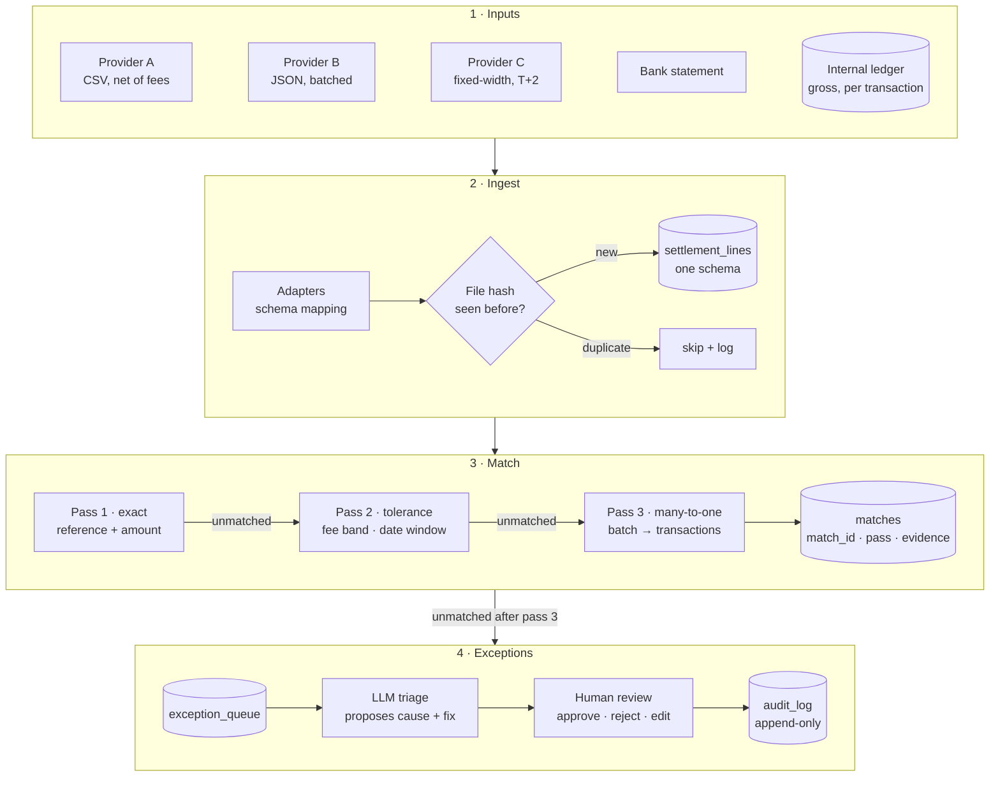
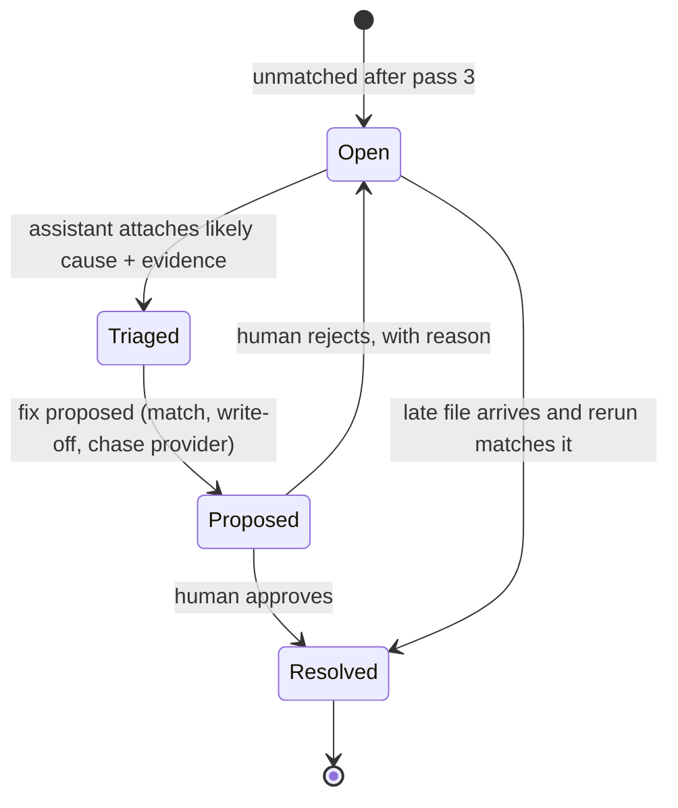

<div align="center">

# Tieout

**Settlement reconciliation that matches every provider to the ledger, and is safe to run twice.**

[](https://github.com/myekini/tieout/actions/workflows/ci.yml)


[](LICENSE)

</div>

> [!NOTE]
> **Status: design stage.** This README is the design. Nothing is built yet. Build starts after [CostTrail](https://github.com/myekini/costtrail) ships its first release.

---

## The question

**Does the money from every provider match, and what happens to what doesn't?**

A payments company takes money through several providers: card processors, transfer networks, wallets. Each one settles on its own schedule, in its own file format, often net of fees, sometimes in batches, sometimes late. The internal ledger records every transaction gross, one row at a time.

Tying the two out by hand breaks in predictable ways:

- A settlement of ₦1,000,000 covers 412 transactions, minus fees. Which 412?
- The same file arrives twice. Did we just count the money twice?
- A provider settles 60% today and the rest on Thursday.
- A reversal lands three days after the original transaction was marked settled.
- Ops fixes a mismatch in a spreadsheet and nobody can say who changed what.

Tieout is a reconciliation engine designed around those failure modes.

## What v1 does

| Capability | Detail |
|---|---|
| **Ingestion adapters** | Three synthetic providers, three formats (CSV, JSON, fixed-width), mapped to one settlement schema |
| **Multi-pass matching** | Exact → tolerance (fees, rounding, date window) → many-to-one (one settlement line covering many transactions) |
| **Fault handling** | Late files, duplicate files and lines, partial settlements, reversals |
| **Exception queue** | Everything unmatched becomes a case with a state, an owner and evidence attached |
| **Idempotent reruns** | Running the same inputs again changes nothing. Tested, not assumed |
| **LLM triage assistant** | Proposes the likely cause and a fix from the evidence. A human approves. Every action is audit-logged |

## Architecture



## Matching, pass by pass

Each pass only sees what the previous pass left unmatched, so cheap, certain matches happen first and expensive, fuzzy ones happen last.

| Pass | Rule | Example |
|---|---|---|
| **1 · Exact** | Same provider reference, same amount, same currency | `txn_30418` ₦48,210.00 ↔ settlement line `txn_30418` ₦48,210.00 |
| **2 · Tolerance** | Same reference, amount differs by no more than the provider's fee schedule, settlement date within the provider's window | Ledger ₦48,210.00, settled ₦47,486.85 (1.5% fee) |
| **3 · Many-to-one** | One settlement line equals the sum of a set of ledger transactions for that provider, within the window, net of fees | One batch line of ₦1,000,000 → 412 transactions |

Every match records **which pass made it and the evidence used**, so an auditor can see why two records were paired.

## Idempotency, by design

Reconciliation jobs get rerun constantly: a file was late, a fix was deployed, someone pressed the button twice. A rerun must never create a second match or a second exception.

| Mechanism | What it prevents |
|---|---|
| Content hash per input file | The same file ingested twice |
| Natural key per settlement line (provider, reference, line number, amount) | Duplicate lines inside or across files |
| Deterministic `match_id` = hash of the sorted record IDs it pairs | The same match written twice |
| `MERGE` writes, never blind `INSERT` | Rows multiplying on rerun |
| Run manifest per `run_id` | Knowing exactly what each run read and wrote |

**The test that proves it:** run the pipeline, snapshot every table, run it again on the same inputs, assert the diff is empty.

## Exception lifecycle



**What the triage assistant can and cannot do**
- It reads the evidence for one case: the unmatched records, nearby candidates, the provider's fee schedule and file history.
- It proposes one cause from a fixed list (fee deduction, duplicate, late file, partial settlement, reversal, missing ledger entry, amount error) and one fix.
- It **cannot** change data. Only an approved proposal does, and the approval, the approver and the before/after state go to the audit log.
- If the evidence doesn't support any cause, it says "insufficient evidence" instead of guessing.

## Planted faults

The generator writes a ground-truth file for every fault it plants, so matching and triage are scored against the truth.

| Planted fault | What it looks like |
|---|---|
| Fee deduction | Settled amount lower than ledger by the fee rate |
| Duplicate file | Same file delivered twice under a new name |
| Duplicate line | Same settlement line repeated inside a file |
| Late file | Settlement arrives after the matching window |
| Partial settlement | One transaction settled across two files |
| Reversal | Transaction reversed after it was matched |
| Missing ledger entry | Money settled for a transaction the ledger never recorded |
| Amount error | Digit transposed in the provider file |

## Evaluation *(planned)*

| Area | Metric |
|---|---|
| Matching | Precision and recall against ground truth, per pass |
| Matching | Share of matches made by each pass |
| Idempotency | Rows changed on a second identical run (must be 0) |
| Triage | Cause-classification precision and recall, per fault type |
| Triage | "Insufficient evidence" rate on cases with no planted cause |
| Operations | Exceptions remaining after each pass |

## Design decisions

| Decision | Why | Trade-off |
|---|---|---|
| Ordered passes, not one fuzzy matcher | Cheap certain matches first; every match is explainable by its pass | More code than a single scoring model |
| Many-to-one bounded by provider and window | Subset-sum is expensive; real batches are constrained | Unusual batches go to exceptions instead of being forced |
| Deterministic IDs + `MERGE` | Reruns are routine, not an incident | Keys must be designed carefully up front |
| Fixed list of causes for triage | Lets triage be scored and keeps the assistant honest | New cause types need a code change |
| Human approval before any data change | Money data needs an accountable person | Slower than auto-fix, on purpose |

## Repository layout

```
tieout/
├── src/
│   ├── generate/     synthetic providers, ledger, planted faults, ground truth
│   ├── ingest/       adapters, file hashing, normalization
│   ├── match/        exact, tolerance and many-to-one passes
│   ├── exceptions/   queue, state machine, audit log
│   └── triage/       evidence builder, LLM client, validator
├── app/              read-only API and exception review UI
├── evals/            ground truth and scored results
├── tests/            unit tests, including the rerun-is-a-no-op test
└── docs/             design notes and decisions
```

## Roadmap

- [x] Repository, CI, design
- [ ] Synthetic providers, ledger and planted faults
- [ ] Ingestion with duplicate-file protection
- [ ] Matching passes 1 to 3 with per-pass evidence
- [ ] Idempotency test in CI
- [ ] Exception queue and audit log
- [ ] Triage assistant and its evaluation
- [ ] First release: one-command run, published scores, walkthrough

## Known limitations

- **Synthetic data.** Results show performance against the generator's assumptions. They do not establish production fraud detection or commercial impact.
- **Three provider shapes.** Real providers have many more edge cases than v1 covers.
- **No fraud or real-time scoring.** Out of scope by design.

---

<sub>Built by <a href="https://github.com/myekini">Muhammad Yekini</a>. Based on problems solved in production payments reconciliation across 33+ providers. No client data, schemas or figures are used.</sub>
